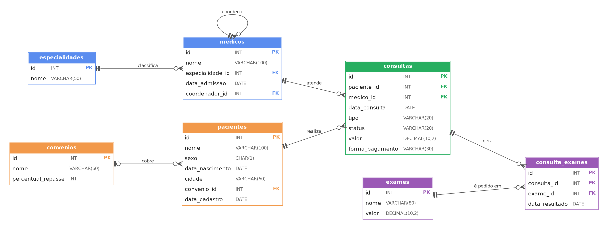

# Análise operacional de uma clínica médica com SQL

> **Projeto de portfólio com dados 100% fictícios**, gerados para estudo. O cenário abaixo é simulado e não representa nenhuma clínica real.


## 1. Contexto e pedido

A **ClinicaVida** é uma clínica médica de médio porte, com 8 especialidades e atendimento tanto particular quanto por convênios. Para o planejamento do próximo ano, a diretoria pediu um **diagnóstico da operação nos últimos 15 meses** (jul/2025 a out/2026), a partir do banco de dados do sistema de agendamento.

> **Pedido da diretoria:**
> "Precisamos entender como está a nossa agenda, de onde vem a receita e quem são os nossos pacientes. Quantas consultas realmente acontecem? Como a receita evoluiu? Quais especialidades e exames sustentam o caixa? Dependemos demais de algum convênio?"

Meu papel neste cenário: **analista de dados**, responsável por transformar o pedido em perguntas objetivas, respondê-las com SQL e devolver conclusões que a diretoria consiga usar.

## 2. Perguntas de negócio

| # | Pergunta | Técnicas de SQL |
|---|----------|-----------------|
| 1 | Qual a proporção de consultas realizadas, canceladas e com falta do paciente? | `GROUP BY`, `COUNT` |
| 2 | Como a receita evolui mês a mês? | `DATE_FORMAT`, `SUM`, filtro por status |
| 3 | Quais especialidades geram mais receita? | `JOIN` de 3 tabelas, `SUM` |
| 4 | Quantos pacientes há por convênio e quantos são particulares? | `LEFT JOIN`, `COALESCE` |
| 5 | Quais exames são mais pedidos e quais geram mais receita? | `JOIN`, `COUNT`, `SUM` |
| 6 | Qual o perfil dos pacientes por faixa etária? | `CASE`, `TIMESTAMPDIFF` |

## 3. Modelo de dados



| Tabela | Descrição | Registros |
|--------|-----------|-----------|
| `especialidades` | Especialidades médicas | 8 |
| `medicos` | Corpo clínico (`coordenador_id` aponta para outro médico) | 14 |
| `convenios` | Convênios e % de repasse sobre o valor particular | 4 |
| `pacientes` | Cadastro de pacientes (`convenio_id` nulo = particular) | 60 |
| `consultas` | Agenda: status, tipo, valor e forma de pagamento | 340 |
| `exames` | Catálogo de exames com valor de tabela | 12 |
| `consulta_exames` | Exames solicitados em cada consulta (`data_resultado` nula = pendente) | 169 |

**Regras do modelo que importam para a análise**
- `consultas.status` pode ser `Realizada`, `Cancelada`, `Faltou` ou `Agendada`. O campo `valor` existe em todas as linhas, mas **só consultas `Realizada` contam como receita**.
- Consultas de convênio têm valor menor: a clínica recebe apenas o percentual de repasse do convênio sobre o preço particular.
- O período vai de 01/07/2025 a 30/10/2026, e consultas após 06/10/2026 estão como `Agendada`.

## 4. Como reproduzir

Requisito: **MySQL 8** (MySQL Workbench, linha de comando ou [DB Fiddle](https://www.db-fiddle.com/) com MySQL 8.0).

1. Crie o schema: `CREATE DATABASE banco_clinica;`
2. Execute [`sql/banco_clinica.sql`](sql/banco_clinica.sql), que cria as tabelas e carrega os dados.
3. Execute as consultas de [`sql/consultas.sql`](sql/consultas.sql).

---

## 5. Análises

### Q1. Quantas consultas realmente acontecem?

```sql
SELECT status,
       COUNT(status) AS qt_consultas
FROM consultas
GROUP BY status
ORDER BY qt_consultas DESC;
```

| status | qt_consultas |
|--------|-------------:|
| Realizada | 271 |
| Faltou | 32 |
| Cancelada | 24 |
| Agendada | 13 |

**Leitura:** das 327 consultas com data até 06/10/2026 (as 13 `Agendada` são futuras), **271 foram realizadas (82,9%)**, 32 tiveram falta do paciente (9,8%) e 24 foram canceladas (7,3%). Ou seja, **cerca de 17% da agenda não virou atendimento**.

---

### Q2. Como a receita evolui mês a mês?

```sql
SELECT DATE_FORMAT(data_consulta, '%Y-%m') AS ano_mes,
       SUM(valor) AS receita_mensal
FROM consultas
WHERE status = 'Realizada'
GROUP BY ano_mes
ORDER BY ano_mes;
```

| ano_mes | receita_mensal (R$) |
|---------|--------------------:|
| 2025-07 | 5.398,00 |
| 2025-08 | 3.804,50 |
| 2025-09 | 3.675,00 |
| 2025-10 | 4.491,50 |
| 2025-11 | 2.720,50 |
| 2025-12 | 4.471,00 |
| 2026-01 | 7.818,00 |
| 2026-02 | 4.000,50 |
| 2026-03 | 3.619,00 |
| 2026-04 | 5.463,00 |
| 2026-05 | 5.081,50 |
| 2026-06 | 6.908,50 |
| 2026-07 | 3.874,00 |
| 2026-08 | 3.225,50 |
| 2026-09 | 3.364,00 |
| 2026-10* | 878,00 |

\* outubro/2026 está incompleto (dados até 06/10).

**Leitura:** a receita total no período é de **R$ 68.792,50**, com média de cerca de **R$ 4.528 por mês** (considerando os meses completos). O melhor mês foi janeiro/2026 (R$ 7.818,00) e o mais fraco, novembro/2025 (R$ 2.720,50). O ponto de atenção é o **3º trimestre de 2026: R$ 10.463,50, uma queda de 40% em relação ao 2º trimestre (R$ 17.453,00)**.


---

### Q3. Quais especialidades geram mais receita?

```sql
SELECT e.nome AS nome_especialidade,
       SUM(c.valor) AS receita
FROM consultas AS c
JOIN medicos AS m
  ON c.medico_id = m.id
JOIN especialidades AS e
  ON m.especialidade_id = e.id
WHERE c.status = 'Realizada'
GROUP BY e.nome
ORDER BY receita DESC;
```

| nome_especialidade | receita (R$) |
|--------------------|-------------:|
| Dermatologia | 14.848,00 |
| Ortopedia | 12.582,50 |
| Cardiologia | 12.521,00 |
| Oftalmologia | 9.126,00 |
| Neurologia | 6.174,00 |
| Ginecologia | 4.860,00 |
| Pediatria | 4.424,00 | 
| Clínica Geral | 4.257,00 | 

**Leitura:** **três especialidades (Dermatologia, Ortopedia e Cardiologia) concentram 58% da receita**. Clínica Geral, Pediatria e Ginecologia, juntas, somam menos de 20%.


---

### Q4. Dependemos demais de algum convênio?

```sql
SELECT COALESCE(c.nome, 'Particular') AS convenio,
       COUNT(p.id) AS qtd_pacientes
FROM pacientes AS p
LEFT JOIN convenios AS c
  ON p.convenio_id = c.id
GROUP BY convenio
ORDER BY qtd_pacientes DESC, convenio;
```

| convenio | qtd_pacientes |
|----------|--------------:|
| Particular | 18 |
| Vida Plena Saúde | 18 |
| MedCenter | 10 |
| Nordeste Saúde | 8 |
| Amparo Saúde | 6 |

**Leitura:** dos 60 pacientes, **70% vêm de convênios**, e a **Vida Plena Saúde sozinha responde por 30%** da base, o mesmo peso dos pacientes particulares. O `LEFT JOIN` com `COALESCE` foi necessário para contar os particulares, que não têm convênio cadastrado (`convenio_id` nulo) e desapareceriam num `INNER JOIN`.


---

### Q5. Quais exames mais saem e quais mais geram receita?

```sql
SELECT e.nome AS nome_exame,
       COUNT(ce.exame_id) AS qtd_solicitada,
       SUM(e.valor) AS receita_total
FROM consulta_exames AS ce
JOIN exames AS e
  ON ce.exame_id = e.id
GROUP BY nome_exame
ORDER BY qtd_solicitada DESC, nome_exame;
```

| nome_exame | qtd_solicitada | receita_total (R$) |
|------------|---------------:|-------------------:|
| Raio-X de Tórax | 24 | 2.640,00 |
| Glicemia de Jejum | 16 | 320,00 |
| Papanicolau | 16 | 1.360,00 |
| Ecocardiograma | 15 | 3.900,00 |
| Eletrocardiograma | 15 | 1.350,00 |
| Hemograma Completo | 15 | 675,00 |
| Mapeamento de Retina | 15 | 2.250,00 |
| Ressonância Magnética | 15 | 11.700,00 |
| Ultrassonografia Abdominal | 15 | 2.700,00 |
| Teste Ergométrico | 13 | 2.860,00 |
| Colesterol Total e Frações | 10 | 550,00 |

**Leitura:** foram 169 exames solicitados, que somam R$ 30.305,00 a valores de tabela. O **Raio-X de Tórax é o mais pedido (24)**, mas a **Ressonância Magnética gera mais receita: R$ 11.700,00, ou 38,6% do total com apenas 15 pedidos**. Volume e receita contam histórias diferentes. Note também que a lista tem 11 exames: um dos 12 do catálogo nunca foi solicitado e, por isso, não aparece no `INNER JOIN`.


---

### Q6. Qual o perfil dos pacientes por faixa etária?

```sql
SELECT CASE
         WHEN TIMESTAMPDIFF(YEAR, data_nascimento, CURDATE()) < 14 THEN 'Criança'
         WHEN TIMESTAMPDIFF(YEAR, data_nascimento, CURDATE()) < 60 THEN 'Adulto'
         ELSE 'Idoso'
       END AS faixa_etaria,
       COUNT(*) AS pacientes
FROM pacientes
GROUP BY faixa_etaria
ORDER BY pacientes DESC;
```

| faixa_etaria | pacientes | 
|--------------|----------:|
| Adulto | 35 |
| Idoso | 15 |
| Criança | 10 |

**Leitura:** a maioria dos pacientes é adulta (58%), mas **um em cada quatro tem 60 anos ou mais**, e crianças são 17% da base.


---

## 6. Conclusões para a diretoria

1. **Absenteísmo:** cerca de 17% da agenda não vira atendimento. Confirmação ativa das consultas e lista de espera são as ações mais baratas.
2. **Receita em queda:** o 3º trimestre de 2026 ficou 40% abaixo do 2º. É preciso investigar as causas antes de definir o orçamento do próximo ano.
3. **Concentração:** 58% da receita vem de 3 especialidades, e 30% dos pacientes pertencem a um único convênio. Ambos são riscos de dependência.
4. **Exames:** a ressonância sustenta mais de um terço da receita de exames com poucos pedidos.
5. **Público:** 1 em cada 4 pacientes é idoso, o que deve orientar a oferta de serviços.

## 7. Premissas e limitações

- **Dados fictícios:** gerados por script com distribuições aleatórias, então os padrões encontrados não refletem uma clínica real.
- **Receita:** considera o valor da consulta realizada (já com o repasse do convênio). A receita de exames usa o valor de tabela multiplicado pela quantidade.
- **Mês parcial:** outubro/2026 contém dados apenas até 06/10.
- **Faixas etárias:** os cortes (14 e 60 anos) foram definidos por mim, e a idade é calculada com `CURDATE()`, então o resultado depende da data de execução.
- **Escopo:** as análises usam apenas consultas de agregação e junção. Análises temporais mais avançadas (rankings, acumulados, comparações entre períodos) ficam como evolução do projeto.

## 8. Habilidades demonstradas

Modelagem relacional (chaves primárias e estrangeiras, auto-relacionamento) · `JOIN` e `LEFT JOIN` · tratamento de valores nulos com `COALESCE` · agregações com `GROUP BY` · `CASE WHEN` · funções de data (`DATE_FORMAT`, `TIMESTAMPDIFF`, `CURDATE`) · tradução de um pedido de negócio em perguntas, análise e recomendações.

## 9. Estrutura do repositório

```
projeto-sql-clinica/
├── README.md
├── sql/
│   ├── banco_clinica.sql   # criação das tabelas e carga dos dados
│   └── consultas.sql       # as 6 análises
└── docs/
    └── diagrama_er.png     # diagrama entidade-relacionamento
```

## 10. Autor

**Victor Nascimento**, analista de dados
🔗 [Portfólio](https://victornasct.lovable.app/) · [LinkedIn](https://www.linkedin.com/in/victor-nasct)
